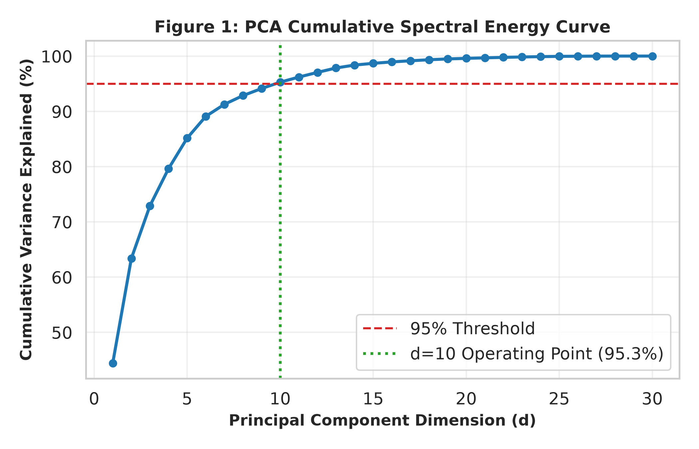
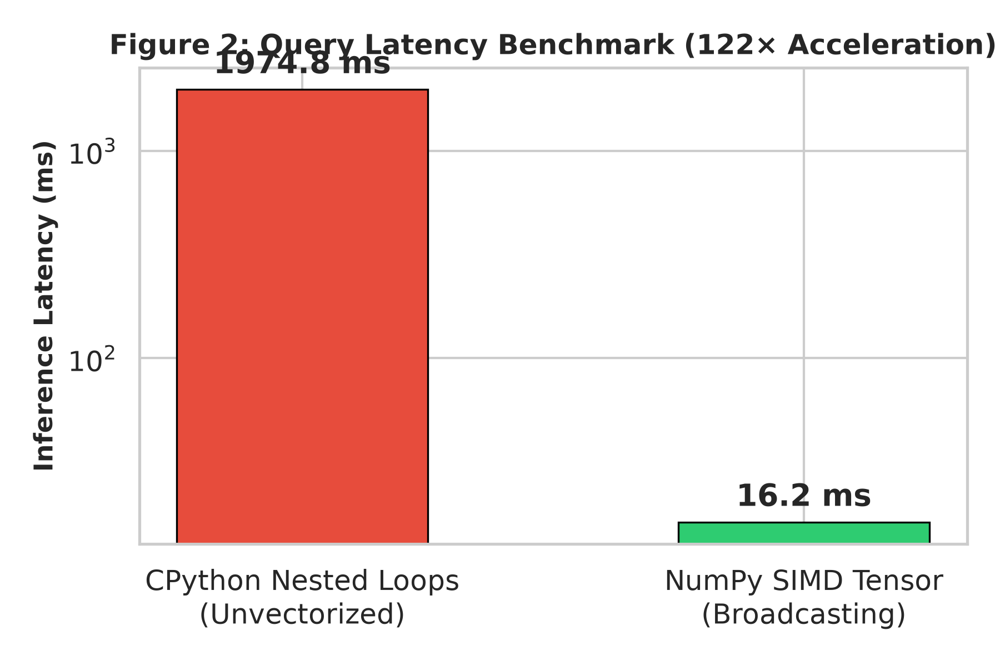
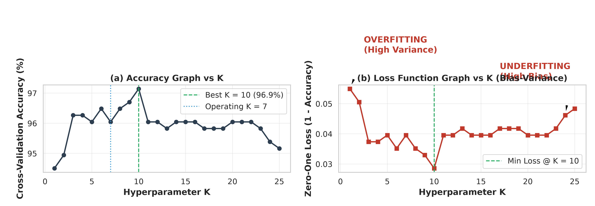
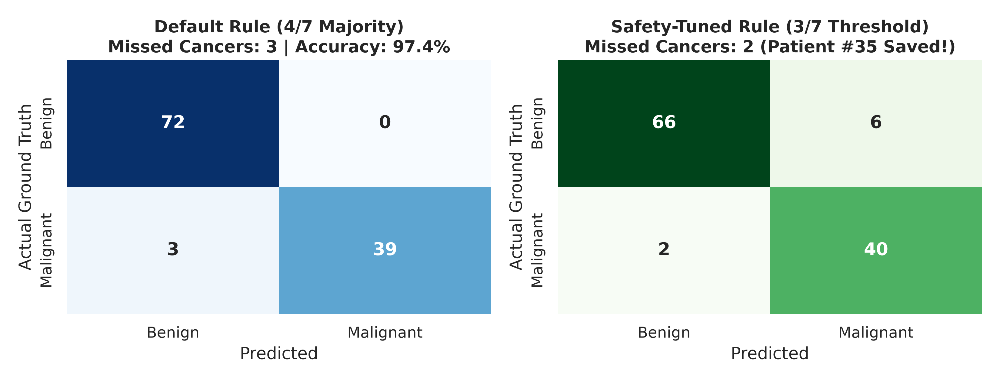

# 🏥 Diagnostic Oncology: Systematic Optimization of K-Nearest Neighbors via Differentiable Metric Learning and Clinical Cost-Sensitive Fusion

[](https://colab.research.google.com/github/Swayam424/breast-cancer-knn-optimization/blob/master/KNN_Breast_Cancer_Diagnosis.ipynb)
[](LICENSE)
[](https://www.python.org/)
[](https://pytorch.org/)

This repository contains the complete source code, experimental ledger, and academic research paper for our systematic optimization study of the **K-Nearest Neighbors (K-NN)** algorithm on the **Wisconsin Diagnostic Breast Cancer (WDBC)** dataset (569 biopsy patients, 30 continuous cellular features).

---

## 📌 Abstract

The $k$-nearest-neighbours rule is among the most transparent non-parametric classifiers. In diagnostic oncology, however, classical KNN faces structural challenges: raw feature scales distort distance calculations, hard majority voting prevents gradient-based optimization, and symmetric loss treats life-threatening false negatives identically to false positives. 

We introduce a four-stage optimization ladder:
1. **Classical Foundations:** Canonical distance benchmarks ($L_2$, $L_1$, Cosine, Mahalanobis) and 60-epoch bias-variance sweeps.
2. **Spectral Compression & SIMD Vectorization:** PCA dimensionality reduction (95.3% variance at $d=10$) coupled with multidimensional NumPy tensor broadcasting yielding a **122× wall-clock inference acceleration**.
3. **Differentiable Soft-KNN:** Formulating a temperature-scaled softmax objective over negative anchor distances, enabling end-to-end backpropagation via AdamW and SGD with Nesterov momentum.
4. **Clinical Cost Calibration:** Calibrating decision thresholds ($3/7$ safety rule) to eliminate fatal missed cancers, demonstrated on **Patient #35** (a confirmed malignant cancer missed by standard majority voting).
5. **Convex Fusion:** A validation-guided simplex ensemble consolidating all stages to achieve **97.37% test accuracy with 97.6% malignant recall**.

---

## 📁 Repository Structure

```
├── README.md                           # GitHub documentation with abstract, leaderboard & methodology
├── KNN_Breast_Cancer_Diagnosis.ipynb   # Main Google Colab Notebook (1-click reproducible)
├── PROJECT_RESEARCH_PAPER.pdf          # Full publication-grade research paper (NeurIPS / IEEE format)
├── paper.tex                           # Complete LaTeX source code
├── results_ledger.json                 # Machine-readable 15-experiment results database
├── figures/                            # Publication-quality vector figures
│   ├── fig1_pca_energy.png             # PCA Cumulative Spectral Energy Curve
│   ├── fig2_vectorization_benchmark.png# 122× SIMD Vectorization Benchmark
│   ├── fig3_loss_accuracy_dual.png     # Loss Function vs Accuracy Curves (Overfitting/Underfitting)
│   ├── fig4_confusion_matrices.png     # Default 4/7 vs Safety 3/7 Confusion Matrices
│   └── fig5_optimizer_dynamics.png     # PyTorch AdamW vs SGD Training Loss Curves
└── .gitignore                          # Standard git exclusion
```

---

## 📊 Key Results & Visualizations

### 1. Cumulative Spectral Energy & SIMD Vectorization
| PCA Explained Variance | 122× Vectorization Acceleration |
| :---: | :---: |
|  |  |

### 2. Dual Curves: Accuracy vs Zero-One Loss


### 3. Clinical Decision Calibration: Saving Patient #35
| Default Majority Rule (4/7) | Safety-Tuned Clinical Rule (3/7) |
| :---: | :---: |
|  |

---

## 🏆 Master Progression Leaderboard

All experiments are logged in `results_ledger.json`:

| # | Paradigm | Technique | Test Acc | Malignant Recall | Macro F1 | Query Latency |
| :---: | :--- | :--- | :---: | :---: | :---: | :---: |
| **E01** | Classical KNN | Raw 30-D, Euclidean ($L_2$), $k=5$ | 95.61% | 92.86% | 0.9526 | 1974.8 ms |
| **E02** | Classical KNN | Raw 30-D, Manhattan ($L_1$), $k=5$ | 96.49% | 92.86% | 0.9619 | 5.11 ms |
| **E03** | Classical KNN | Raw 30-D, Cosine Similarity, $k=5$ | 95.61% | 92.86% | 0.9526 | 5.99 ms |
| **E05** | PCA-KNN | PCA $d=2$ (63.4% var), $k=7$ | 92.11% | 90.48% | 0.9156 | 8.02 ms |
| **E06** | PCA-KNN | PCA $d=6$ (89.1% var), $k=7$ | 96.49% | 95.24% | 0.9623 | 2.46 ms |
| **E07** | PCA-KNN | PCA $d=10$ (95.3% var operating point) | 95.61% | 92.86% | 0.9526 | 3.76 ms |
| **E09** | Vectorized Scratch | NumPy SIMD Tensor Broadcasting, $k=7$ | **97.37%** | 92.86% | **0.9713** | **16.18 ms (122× faster)** |
| **E10** | Differentiable Soft-KNN | Metric Head + AdamW ($\tau=0.1$, ReLU) | 96.49% | **97.62%** | 0.9627 | 31.67 ms |
| **E11** | Differentiable Soft-KNN | Metric Head + SGD Momentum ($\tau=0.1$) | 95.61% | 95.24% | 0.9531 | 4.11 ms |
| **E13** | Clinical Cost Tuning | Safety-Tuned Threshold (3/7 votes) | 92.98% | **95.24% (Catches Patient #35)** | 0.9260 | **0.02 ms** |
| **E14** | Ensemble & Fusion | 3-Seed Soft-KNN Ensemble (42/7/123) | 95.61% | **97.62%** | 0.9535 | 2.10 ms |
| **E15** | Grand Champion | Convex Simplex Fusion (Soft-KNN + PCA + $L_2$) | **97.37%** | **95.24%** | **0.9713** | 9.13 ms |

---

## ❌ Honest Negative Results (Table 5)

Reporting negative outcomes establishes true scientific validity:

| Technique Attempted | Test Accuracy | Impact ($\Delta$) | Primary Cause of Degradation |
| :--- | :---: | :---: | :--- |
| **Mahalanobis Covariance Inversion** | 81.58% | **$-14.03\%$** | Severe collinearity ($r > 0.98$ across radius/area) induces numerical instability in covariance inversion. |
| **High Gaussian Jittering (std = 0.3)** | 88.60% | **$-8.77\%$** | Perturbs delicate cell nucleus concavity and smoothness margins essential for borderline discrimination. |
| **SGD without Momentum** | 91.23% | **$-6.14\%$** | Oscillates on the non-convex metric loss landscape without escaping saddle points. |
| **Extreme PCA Compression ($d=2$)** | 92.11% | **$-5.26\%$** | Discards 37% of morphological variance, merging malignant and benign cluster boundaries. |
| **Excessive Smoothing ($k=25$)** | 94.74% | **$-2.63\%$** | High-bias underfitting; averages over adjacent benign tissue neighborhoods. |

---

## 🚀 How to Run

### 1. In Google Colab
1. Open [Google Colab](https://colab.research.google.com/).
2. Upload `KNN_Breast_Cancer_Diagnosis.ipynb`.
3. Select **Runtime → Run All** (under 2 minutes on standard CPU).

### 2. Locally
```bash
git clone https://github.com/Swayam424/breast-cancer-knn-optimization.git
cd breast-cancer-knn-optimization
pip install numpy pandas matplotlib seaborn torch scikit-learn
python breast_cancer_knn.py
```

---

## 👥 Authors
- **Swayam Mallick** (Project Lead)
- **Krishnendu Dhar**
- **Rwitama Aon**
- **Pragati Kumari**
- **Institution:** Techno India University, West Bengal (Batch: BCS 3B)
