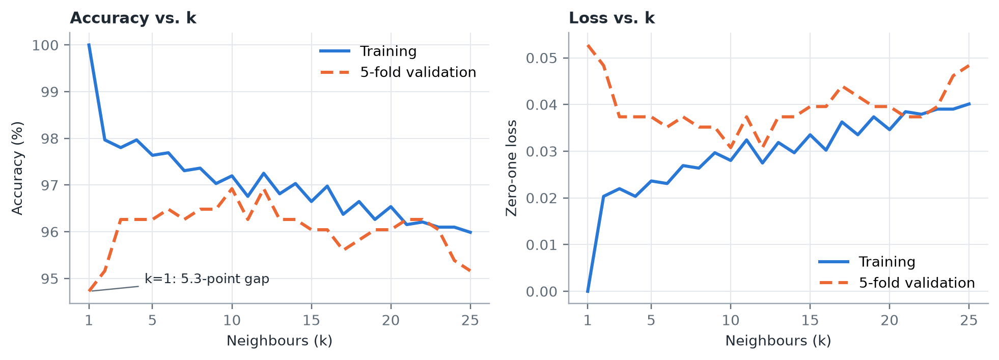
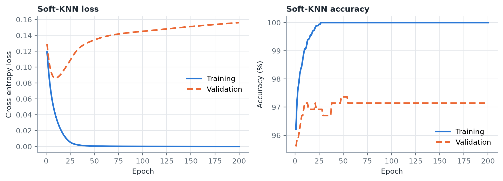
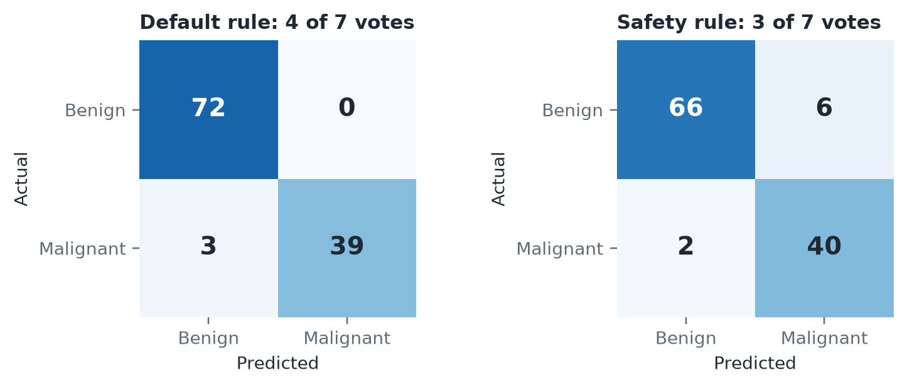

<div align="center">

# K-Nearest Neighbours for Breast Cancer Diagnosis

Implementing, optimising and stress-testing K-NN on the Wisconsin Diagnostic Breast Cancer dataset

[](https://colab.research.google.com/github/Swayam424/breast-cancer-knn-optimization/blob/master/KNN_Breast_Cancer_Diagnosis.ipynb)


**[Read the project report (PDF)](reports/KNN_Project_Report.pdf)** · **[Open the notebook](KNN_Breast_Cancer_Diagnosis.ipynb)**

</div>

## Overview

Can a simple, explainable classifier tell malignant tumours from benign ones using measurements of cell nuclei? This project, built for the ML Theory assignment, answers that with K-NN and examines which optimisations genuinely help.

The two possible errors are not equally serious: a false alarm leads to further tests, while a missed cancer delays treatment. Results therefore report **malignant recall** alongside accuracy.

| Finding | Result |
| :--- | :--- |
| Expected accuracy, K-NN with k=7 (repeated 5-fold CV) | **96.55% ± 1.61** |
| Accuracy on the held-out test split, k=7 | **97.37%** |
| Malignant recall with the 3-of-7 safety rule | **95.24%** (2 of 42 cancers missed, 6 false alarms) |
| Fewest missed cancers: 3-seed Soft-KNN ensemble | **97.62% recall** (1 missed, 4 false alarms) |

> This is a coursework study on a small benchmark dataset. It is not a medical device and must not guide patient care.

## Dataset

[Wisconsin Diagnostic Breast Cancer](https://archive.ics.uci.edu/dataset/17/breast+cancer+wisconsin+diagnostic) (also on [Kaggle](https://www.kaggle.com/datasets/uciml/breast-cancer-wisconsin-data)): 569 samples, 357 benign and 212 malignant, with 30 continuous features. The code loads the same data through scikit-learn, so no download is needed.

## Method

1. **Split** the data 80/20 with stratification (seed 42), holding out 114 test samples.
2. **Standardise** features using training statistics only.
3. **Compare distance metrics:** Euclidean, Manhattan, cosine and Mahalanobis.
4. **Tune** `k` from 1 to 25 and compress features with PCA.
5. **Optimise** with Soft-KNN, a differentiable variant trained by backpropagation, comparing optimisers, activations and augmentation.
6. **Calibrate** the malignant vote threshold and evaluate the trade-off.

## Results

| Configuration | Test accuracy | Malignant recall | Macro F1 | Missed cancers | False alarms |
| :--- | ---: | ---: | ---: | ---: | ---: |
| Euclidean, k=5 | 95.61% | 92.86% | 0.9526 | 3 | 2 |
| Manhattan, k=5 | 96.49% | 92.86% | 0.9619 | 3 | 1 |
| Cosine, k=5 | 95.61% | 92.86% | 0.9526 | 3 | 2 |
| Mahalanobis, k=5 | 81.58% | 50.00% | 0.7697 | 21 | 0 |
| **Euclidean, k=7** | **97.37%** | 92.86% | **0.9713** | 3 | 0 |
| PCA d=2, k=7 | 92.11% | 90.48% | 0.9156 | 4 | 5 |
| PCA d=6, k=7 | 96.49% | 95.24% | 0.9623 | 2 | 2 |
| Euclidean, k=7, 3-of-7 rule | 92.98% | 95.24% | 0.9260 | 2 | 6 |
| Soft-KNN ensemble (3 seeds) | 95.61% | **97.62%** | 0.9535 | 1 | 4 |

One test sample moves accuracy by 0.88 points, and the 95% margin around 97% is about ±3.1 points, so small differences here are not meaningful.

## Optimisation

Neural results are averaged over 10 seeds, because a single run can mislead.

| Technique | Setting | Test accuracy | Malignant recall |
| :--- | :--- | ---: | ---: |
| Optimiser | AdamW | 95.53% ± 0.92 | 96.43% |
| | SGD + momentum | 95.18% ± 1.13 | 95.24% |
| | SGD, no momentum | 94.04% ± 1.75 | 93.57% |
| Activation | GELU (AdamW) | 95.53% ± 0.92 | 96.43% |
| | ReLU (AdamW) | 95.18% ± 0.71 | 95.71% |
| Regularisation | Early stopping, epoch 9 | 95.26% ± 1.05 | 95.00% |
| Augmentation (K-NN) | Gaussian jitter, std 0.3 | 96.23% ± 0.79 | 92.86% |

- **Tuned variants rarely beat the baseline.** The classes are well separated, so most differences fall within noise.
- **The practical gain is clinical.** Lowering the vote threshold catches one more cancer, at the cost of six false alarms.
- **Code speed improves cleanly.** NumPy broadcasting gives identical predictions about 22× faster than Python loops on the test machine.

## Loss and accuracy

**K-NN across `k`.** K-NN has no epochs, so loss is zero-one loss plotted against `k`.



**Soft-KNN across epochs.** Curves use a validation split carved from the training data.



## Overfitting and underfitting

| Model | Training | Validation | Diagnosis |
| :--- | ---: | ---: | :--- |
| K-NN, k=1 | 100.00% | 94.73% | **Overfitting:** memorises noise, 5.27-point gap |
| K-NN, k=7 | 97.31% | 96.26% | **Balanced:** 1.04-point gap, near the validation plateau |
| K-NN, k=25 | 95.99% | 95.16% | **Mild underfitting:** both scores fall as bias rises |
| Soft-KNN, 200 epochs | 100.00% | 97.14% | **Overfitting:** validation loss climbs from 0.086 to 0.156 as training loss nears zero |

## Clinical threshold



Test patient #35 has a malignant tumour and receives 3 of 7 malignant votes, so the default rule misses it and the safety rule catches it. Two other cancers still go undetected. The threshold was examined on the test split, so this result is illustrative; a real deployment would select it on separate validation data with clinical input.

## Run it

**Google Colab:** select the badge above, upload `results_ledger.json` to the session (the last cell reads it), then choose **Runtime → Run all**.

**Reproduce the report:**

```bash
git clone https://github.com/Swayam424/breast-cancer-knn-optimization.git
cd breast-cancer-knn-optimization
pip install -r requirements.txt
python reports/analysis.py        # recomputes results and charts
python reports/build_report.py    # rebuilds the PDF
```

## Repository structure

```text
├── KNN_Breast_Cancer_Diagnosis.ipynb   Main Colab notebook
├── reports/
│   ├── KNN_Project_Report.pdf          Project report
│   ├── analysis.py                     Recomputes every reported result
│   ├── build_report.py                 Builds the PDF
│   ├── results_verified.json           Verified results
│   └── figures/                        Report charts
├── PROJECT_RESEARCH_PAPER.pdf          Earlier team paper
├── paper.tex                           LaTeX source of the earlier paper
├── results_ledger.json                 Original experiment log
├── figures/                            Original notebook figures
└── requirements.txt                    Python dependencies
```

## Notes and limitations

- **Verified numbers:** this README and the report use `reports/results_verified.json`. Some figures in the earlier paper and `results_ledger.json` differ; [Appendix A of the report](reports/KNN_Project_Report.pdf) lists each one.
- **Convex fusion (E15):** the earlier paper reports this model, but the repository has no implementation of it, so it is excluded here.
- **Evaluation:** the data is small and from a single source, and the test split informed several comparisons. Repeated cross-validation is the fairest estimate.

## Team

**Swayam Mallick** (Project Lead) · **Krishnendu Dhar** · **Rwitama Aon** · **Pragati Kumari**

Techno India University, West Bengal · Batch BCS 3B

## References

- W. H. Wolberg, W. N. Street, O. L. Mangasarian. *Breast Cancer Wisconsin (Diagnostic)*. UCI Machine Learning Repository, 1995.
- T. Cover, P. Hart. *Nearest neighbor pattern classification*. IEEE Transactions on Information Theory, 1967.
- J. Goldberger et al. *Neighbourhood components analysis*. NeurIPS, 2004.
